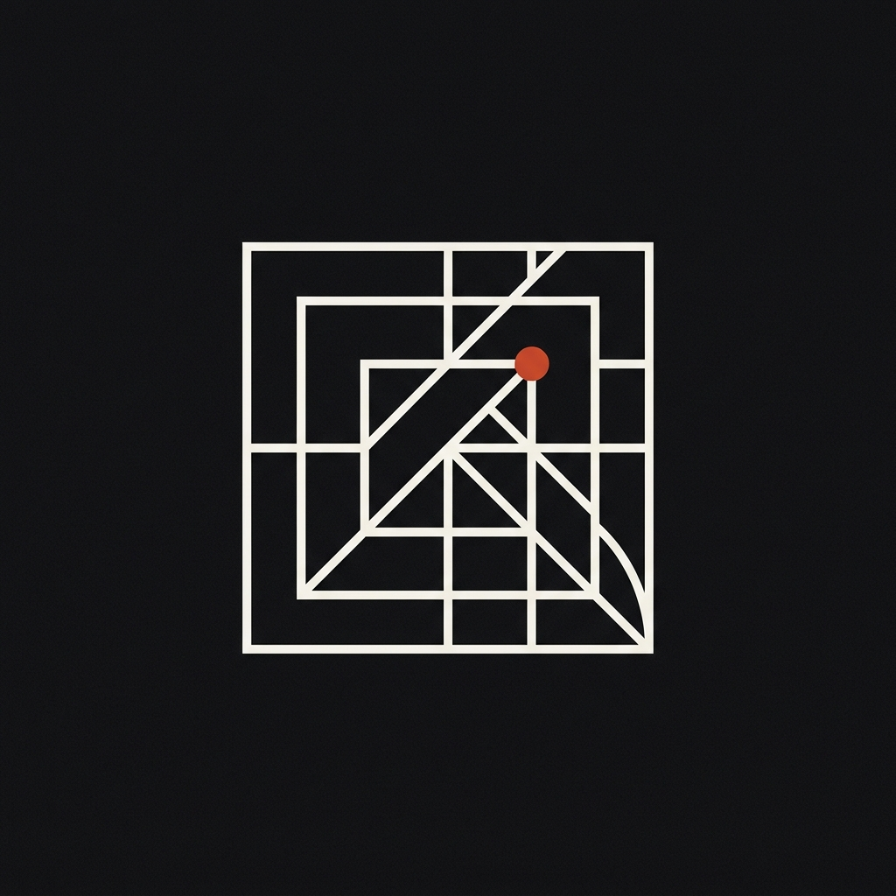

<p align="center">
  
</p>

<h1 align="center">UI Design Craft (Anti-AI-Slop Plugin)</h1>

<p align="center">
  An Antigravity plugin combining always-on UI design rules, a cross-platform craft skill, and an automated Stop-hook code auditor so AI-generated interfaces never look like generic AI templates.
</p>

---

## Why This Exists

Without explicit constraints, AI-generated UI converges on the same synthetic patterns: dark-slate backgrounds with indigo/purple gradients, uniform 3-column card grids ("carditis"), sparkle emojis, unloaded webfonts falling back to Arial, broken contrast on bright accents, and generic SaaS templates pasted into desktop tools, mobile apps, or video games.

**UI Design Craft** fixes this at three layers:

1. **Always-On Rule (`rules/AGENTS.md`)** — Automatically enforces a Pre-Code Design Brief, restrained 60-30-10 color plans (max 1 focal accent, no multi-neon rainbow soup), verified typography pairings, bespoke inline `<svg>` icons/silhouettes, open user-friendly layouts, and platform-native ergonomics on every UI task.
2. **Cross-Platform Skill (`skills/ui-design-craft/`)** — Detailed workflows and references covering:
   - **Web & Generative UI** (HTML/CSS, Tailwind, React, Next.js, Vue, Svelte, Astro)
   - **Desktop Applications** (Electron, Tauri, Qt, WinUI, SwiftUI, GTK — split panes, compact toolbars, status bars, `⌘K` workflows)
   - **Mobile Applications** (iOS, Android, React Native, Flutter — thumb-zone reachability, `SafeArea`, bottom sheets, `>= 44pt/48dp` targets)
   - **Video Game Interfaces** (HUDs, menus, inventories, dialogue — live-backdrop scrims, 5% safe zones, 10-foot/handheld scale, bespoke `<svg>` item silhouettes, mouse + gamepad dual navigation)
3. **Automated Anti-Slop Stop Hook (`hooks.json` + `audit_ui_slop.mjs`)** — Scans UI files modified during a turn and flags measurable slop (`✨`/`🚀`/`📦` emoji crutches, `"Supercharge"`/`"Acme Corp"` placeholder copy, slate+indigo/purple gradients, `bg-clip-text` gradient headlines, `hover:scale-105` wobble, `<div onClick>`, missing `:focus-visible` rings, low-contrast `text-white` on bright amber/lime/cyan, multi-neon rainbow soup, missing custom `<svg>` art, unloaded HTML webfonts, or display-only fonts applied globally to `body`).

---

## Repository Layout

```text
ui-design-craft/
├── plugin.json
├── hooks.json
├── rules/
│   └── AGENTS.md
├── scripts/
│   └── stop_ui_audit_hook.mjs
├── skills/
│   └── ui-design-craft/
│       ├── SKILL.md
│       ├── references/
│       │   ├── anti-slop-catalog.md
│       │   ├── design-tokens-and-typography.md
│       │   ├── layout-and-domain-archetypes.md
│       │   └── states-a11y-and-verification.md
│       └── scripts/
│           └── audit_ui_slop.mjs
└── assets/
    ├── icon.jpg
    ├── logo.png
    └── logo.svg
```

---

## Installation (Antigravity)

Clone or copy this folder into your global Antigravity plugins directory:

### Windows (PowerShell)

```powershell
git clone https://github.com/irfandemir00/ui-design-craft.git "$env:USERPROFILE\.gemini\config\plugins\ui-design-craft"
```

### macOS / Linux

```bash
git clone https://github.com/irfandemir00/ui-design-craft.git ~/.gemini/config/plugins/ui-design-craft
```

Restart or start a new Antigravity conversation; the plugin is discovered automatically.

---

## Standalone CLI Audit Usage

You can also run the zero-dependency UI auditor manually against any file or project directory (requires Node.js):

```bash
node skills/ui-design-craft/scripts/audit_ui_slop.mjs ./src
```

---

## License

[MIT](./LICENSE)
